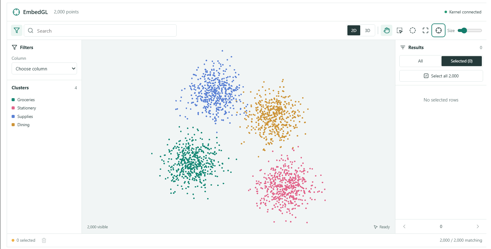

# Embedgl

A React/Three.js anywidget for exploring precomputed 2D and 3D projections in JupyterLab or another anywidget-compatible notebook. An eager Polars DataFrame owns the data in Python. Column search and filters determine which points render; image bytes and metadata are requested on demand.



## Install

Install into the same environment as your notebook kernel:

```sh
pip install embedgl
```

For a local checkout, run `pip install -e .` from the repository root. Python 3.12 or newer is required.

The built JavaScript/CSS assets are included under `embedgl/static` in the installed package. Normal notebook use needs neither Node.js nor a frontend server. No separate custom JupyterLab extension is required; the notebook must support ipywidgets/anywidget and WebGL. In JupyterLab, install `jupyterlab_widgets` in the JupyterLab server environment if it is separate from the kernel environment.

## Try It

Run in a notebook cell:

```python
from embedgl.demo import make_demo

viewer = make_demo()
viewer
```

The demo generates a small Polars DataFrame and synthetic receipt thumbnails locally. It does not load source receipt images or any ML models. Open [examples/usage.ipynb](examples/usage.ipynb) in JupyterLab or VS Code after installing the package, select the environment where `embedgl` is installed, and run the cells in order.

## Your DataFrame

Provide precomputed coordinate columns. **The viewer does not compute projections or clusters.**

```python
from embedgl import EmbeddingViewer

viewer = EmbeddingViewer(
    frame,
    id_column="hash_id",
    coordinates_2d=("umap_x", "umap_y"),
    coordinates_3d=("umap3_x", "umap3_y", "umap3_z"),
    cluster_column="cluster",
    thumbnail_column="thumbnail",
    image_column="image",
    searchable_columns=("file_name", "ocr_text"),
    filterable_columns=("file_name", "cluster", "amount", "reviewed"),
    metadata_columns=("file_name", "source_path", "amount"),
    height=700,
)
viewer
```

Pass only columns that exist in your frame. At least one coordinate set is required; omit `coordinates_3d`, `cluster_column`, `image_column`, or other optional mappings when unavailable. 

- IDs must be unique, non-null strings or integers. Original ID types, including 64-bit integers, stay in Python; browser messages use dense uint32 row indices.
- Coordinates must be finite numeric values with no nulls. The renderer normalizes their scale locally without modifying the frame.
- Images must be Polars `Binary` columns containing JPEG, PNG, WebP, or GIF bytes. An absent default `thumbnail` column is allowed; pass `thumbnail_column=None` for a point-only view. Filesystem paths and remote URLs are not automatically opened.
- Search columns must be string-like. Search is case-insensitive literal substring matching across those columns (OR), combined with filters (AND). Empty search matches all rows.
- Filter columns support strings/categories, numeric values, booleans, dates, and datetimes. Flatten struct fields before configuring them. List/embedding columns are not filterable.
- Metadata is an explicit scalar-column whitelist. The ID column is always included. The first two configured metadata columns label result rows. Page text is capped at 2,000 characters per value; requested detail text is capped at 100,000. Binary/nested metadata is rejected. Large integers are represented as strings in metadata responses.
- The DataFrame is treated as an immutable snapshot. Use `replace_data(new_frame)` to load a replacement with the same configured columns. This clears queries, selections, and browser caches.

## Search and Filters From Python

```python
viewer.set_search("coffee")
viewer.set_filters(
    [
        {"column": "amount", "op": "gte", "value": 10},
        {"column": "amount", "op": "lte", "value": 75},
        {"column": "reviewed", "op": "eq", "value": True},
    ]
)

viewer.set_search("")
viewer.set_filters([])
```

Supported filter operations:

| Operation | Value | Columns |
| --- | --- | --- |
| `contains` | String | String/category |
| `eq` | Scalar | Any configured filter column |
| `in` | List of scalars, at most 1,000 | Any configured filter column |
| `gte`, `lte` | Inclusive bound | Numeric/date/datetime |
| `is_null`, `not_null` | No value | Any configured filter column |

Pass dates/datetimes as ISO strings, with timezone presence matching the column dtype. Boolean values must be actual booleans, not strings. Decimal/integer bounds can be strings to preserve precision. Ordinary comparisons do not match nulls. Filters are limited to 32 predicates and 64 KiB of JSON. Text search is limited to 4,096 characters. The UI offers the first 100 distinct string values as suggestions; custom values remain accepted. The `in` control accepts a JSON array.

Accepted search/filter changes immediately clear selection and hide unmatched points. They do not resend coordinates or automatically move the camera. Use **Fit matching points** to frame the remaining points explicitly. Results retain source-row order and are paginated 30 at a time.

## Selection

```python
viewer.selected_ids
selected_frame = viewer.selected_df

viewer.set_selection(["some-stable-id"])
viewer.set_selection(["another-id"], mode="add")
viewer.set_selection(["some-stable-id"], mode="remove")
viewer.clear_selection()
```

Use the pan/orbit, rectangle-selection, and circular-selection toolbar modes. For circular selection, press at the desired center, drag outward to set the radius, and release to select. The center stays fixed at the initial press position. Clicking a point in pan/orbit or rectangle mode selects the nearest point; result checkboxes and image details also change selection. Hold Shift to add and Alt to remove during canvas selection. **Select all results** includes every matching row, not just the displayed page. In both 2D and 3D, area selection uses projected screen positions. In 3D, rectangles and circles include all matched points inside their screen-space boundary and camera clip volume, including points behind others.

Programmatic selection can include currently filtered-out rows, which stay selected in Python but are not rendered. A subsequent accepted query change clears the complete selection. `selected_df` preserves source-row order. For change notifications, standard widget observation is available:

```python
def selection_changed(change):
    print(viewer.selected_count)


viewer.observe(selection_changed, names=["selection_revision"])
```

Cluster labels only assign colors (an eight-color palette, repeated for larger cluster counts). Hover shows up to 12 nearest overlapping screen-space points, not all members of the semantic cluster. Click a preview to inspect its image and whitelisted metadata.

## Frontend Development

Run these commands from the repository root with Node.js 22 and npm:

```sh
npm ci
npm run build
uv sync
```

The build typechecks the frontend, bundles React, Three.js, icons, and the inline worker into `src/embedgl/static/widget.js` and `src/embedgl/static/widget.css`, and generates `src/embedgl/THIRD_PARTY_LICENSES.txt`. Commit these generated files so installing a checkout or source distribution does not require Node.js. For continuous compilation:

```sh
npm run watch
```

For notebook hot reload, set `ANYWIDGET_HMR=1` before importing the widget. Otherwise create a new widget after rebuilding, or restart the kernel if the old module is cached. Run the full build again before releasing; watch mode does not typecheck or regenerate license notices.

## Release Checks

The Python package lives under `src/embedgl`; frontend sources and examples are not importable Python packages. The version is maintained explicitly in `pyproject.toml`, not derived from Git tags. Update it for each release; PyPI does not allow replacing an uploaded version.

From a clean checkout, build and validate with:

```sh
npm ci
npm run build
uv sync --group dev
uv run python -m unittest discover -s tests -v
uv run python -m build
uv run python scripts/check_dist.py
uv run python -m twine check --strict dist/*
```

Start with an empty `dist` directory so old releases are not mixed with the new one. The build rejects missing or empty JS, CSS, or third-party notices. The archive check verifies that the wheel and source distribution contain the same compiled assets. Python builds use the prebuilt assets and never download frontend dependencies.

The release-check workflow runs on Linux and Windows, builds the wheel from the source distribution, and runs tests against that wheel outside the checkout. Before uploading, also render `embedgl.demo.make_demo()` in a real JupyterLab notebook and check 2D/3D views, picking, image previews, and selection. Automated Python checks do not verify browser rendering or performance.

### Publish From GitHub

Publishing a non-prerelease GitHub release runs the release-check workflow against the tagged commit. Both Linux and Windows must pass before a separate job uploads the validated Linux-built wheel and source distribution to PyPI. Pushes, pull requests, manual workflow runs, tag pushes alone, draft releases, and releases marked as prereleases do not publish to PyPI. Authentication uses PyPI Trusted Publishing (OIDC); no PyPI API token or GitHub secret is needed.

One-time setup (repository `M-Anwar/embedgl`):

1. In GitHub, open **Settings > Environments > New environment** and create `pypi`. Under its deployment branch/tag rules, select **Selected branches and tags** and add a **tag** rule matching `v*`. Optionally add required reviewers if your repository plan supports them; each upload will then wait for approval.
2. Log in to PyPI with two-factor authentication enabled. For an existing `embedgl` project you own, open **Manage > Publishing > Add a new publisher**. For a first upload, use [PyPI's pending publisher form](https://pypi.org/manage/account/publishing/) and set the project name to `embedgl`. A pending publisher does not reserve a name; if someone else owns it, you need ownership or a different package name.
3. Choose GitHub and enter these exact values: owner `M-Anwar`, repository `embedgl`, workflow filename `release-check.yml` (not its path or display name), and environment `pypi`.
4. Commit and push the workflow and release changes. Keep the workflow on the default branch and on any branch you plan to release. Ensure GitHub Actions is enabled for the repository.

For each release:

1. Set a new, unused `[project].version` in `pyproject.toml`, rebuild and commit frontend assets if they changed, and push the release-ready commit to your chosen branch. Run the release checks and notebook smoke test above.
2. In GitHub, open **Releases > Draft a new release**. Under **Choose a tag**, enter `v` followed by the exact project version, such as `v1.0` for version `1.0`. Create the new tag on publish and select your release branch in **Target**. When selecting an existing tag, its commit is used regardless of the current branch tip.
3. Add a title and release notes, leave **Set as a pre-release** unchecked, and click **Publish release**. The workflow rejects tags that do not exactly match the version in the tagged commit; it does not change the version automatically.
4. Follow **Actions > Release checks**. Approve the `pypi` deployment if required, then verify the new version on [PyPI](https://pypi.org/project/embedgl/).

PyPI does not allow overwriting a published version or reusing deleted distribution filenames. For a corrected release, increment the version and create a new tag/release; do not move an old release tag. A failed run before uploading can be rerun after fixing external setup, but an upload that already succeeded must not be repeated. The workflow deliberately does not ignore existing files.

Manual publishing remains available with `uv run python -m twine upload dist/*` after local validation. Authenticate through your usual secure PyPI workflow; never commit credentials.

## Data Flow and Limitations

The ready view requests coordinates in paced chunks of up to 65,536 points. Geometry is float32 positions plus uint32 cluster codes; row order is implicit. Each requested dimension mode is cached per browser model. All large buffers use custom messages, not synced traits or saved notebook state. Filtering sends only uint32 match indices; selection uses the same compact representation. Images are fetched at most four at a time and held in a 32 MiB browser LRU cache; a single image is limited to 20 MiB.

Three.js renders a buffer-based point cloud. A per-view Web Worker projects matched points and builds a KDBush index after camera motion settles. Hover and rectangle picking are briefly suspended while that index rebuilds. Multiple displays of the same widget share query/selection/data state but have independent cameras. Close/dispose outputs to release their GPU/worker resources.

Operation requires a live, responsive notebook kernel. Saved output is not an offline data export. Long-running notebook computations delay query/image responses; a 30-second timeout exposes a reconnect action. Search/filter evaluation runs synchronously in the kernel in this first version. Browser geometry, per-view GPU buffers, worker indexing, and match masks consume additional memory beyond the Polars frame.

The design targets 100,000–1 million points, but capacity and frame rate depend on hardware and data. Python smoke tests and distribution-content checks are included. Live notebook behavior and million-point performance require separate browser testing and benchmarks.